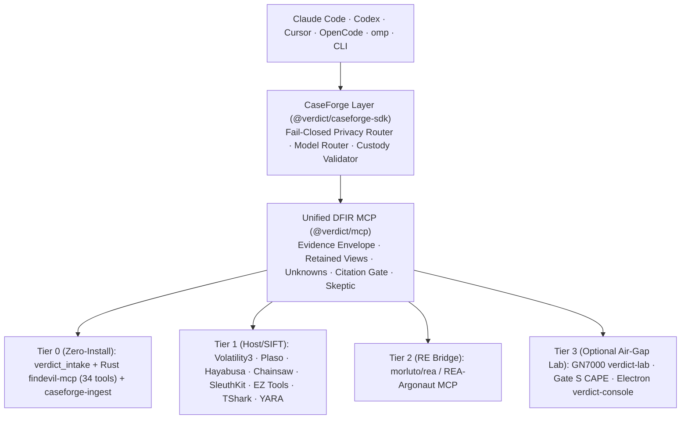

# VERDICT Architecture — REA for DFIR

## Design Thesis

VERDICT adopts the architectural blueprint of [`morluto/rea`](https://github.com/morluto/rea) (Reverse Engineer Anything) and applies it to **Digital Forensics & Incident Response (DFIR)**, merging our own `verdict-dfir-beta` + `caseforge-core` with the highest-leverage verified patterns from the 2026 SANS Find Evil & AI-DFIR winning apps.

## Implemented in v1.0 (This Monorepo)

1. **Unified REA-for-DFIR MCP Server (`packages/verdict-mcp`)**
   - Deterministic content-addressed `evidence_id` (`ev_<sha256>`) + hash-chained append-only audit log.
   - `detail: "summary"` + `inspect_analysis_view` retained-evidence paging (prevents context overflow).
   - `record_unknown` / `update_unknown` with optimistic revision locking and evidence-backed resolution.
   - **Mulder API-boundary citation gate**: `record_finding` rejects nonexistent `evidence_refs` and auto-nullifies malformed timestamps.
   - **VERDICT forensic schema rules**: `>=2` distinct artifact-class corroboration for `confirmed` findings; mandatory Amcache LastModified caveat.
   - **SIFT++ / TRUDI Skeptic challenge**: `challenge_finding` transitions findings to `confirmed` | `inferred` | `refuted` | `uncertain`.
   - Honest `verdict_summary` (`SUSPICIOUS` | `INDETERMINATE` | `NO_EVIL`) refusing `NO_EVIL` when coverage is incomplete or unknowns remain open.
2. **Unified CLI (`packages/verdict-cli`)**
   - `verdict doctor`, `verdict setup` (read-only plan), `verdict models` (CaseForge privacy router), `verdict intake`, `verdict verify`, `verdict serve`.
3. **Multi-Client Distribution**
   - `.agents/skills/verdict-dfir/SKILL.md` + `.claude-plugin/` + `.codex-plugin/` + `.cursor-plugin/`.
4. **Consolidated Engines**
   - `services/mcp` (`findevil-mcp` Rust 34 tools), `services/agent_mcp` (Python Ed25519 custody), `services/agent` (0-LLM deterministic engine), `packages/caseforge-sdk`, `crates/caseforge-fleet`, `crates/caseforge-ingest`.

## Winning-Apps Merge Roadmap (Next Increments)

| Priority | Capability | Source Inspiration | Target Package |
|---|---|---|---|
| P1 | Per-case SQLite FTS5 index across all extracted artifacts | Mulder | `crates/caseforge-ingest` + `packages/verdict-mcp` |
| P2 | Attackable spoliation & tamper test suite (`scripts/attack-custody.sh`) | Protocol SIFT++ / FindEvil | `scripts/` + CI |
| P3 | Static HTML case report + Super-Timeline + Evidence Chain Graph + STIX 2.1 / ATT&CK Navigator | Mulder + DFIR-Companion *(clean-room, no AGPL code)* | `packages/verdict-report` |
| P4 | Linux dead-disk typed parser pack (journald, systemd, `authorized_keys`, sudoers, webshells, `LD_PRELOAD`) | marlyocat/findevil | `services/mcp` |
| P5 | DAIR phase director (`conduct_assess` with bounded `priority_tools` + curiosity budget) | TRUDI | `packages/verdict-mcp` |
| P6 | Native bridge to `morluto/rea` / `REA-Argonaut` for binary/malware reversing + CAPA/FLOSS/DIE triage | REA + REA-Argonaut + Malvex | `packages/verdict-mcp` |
